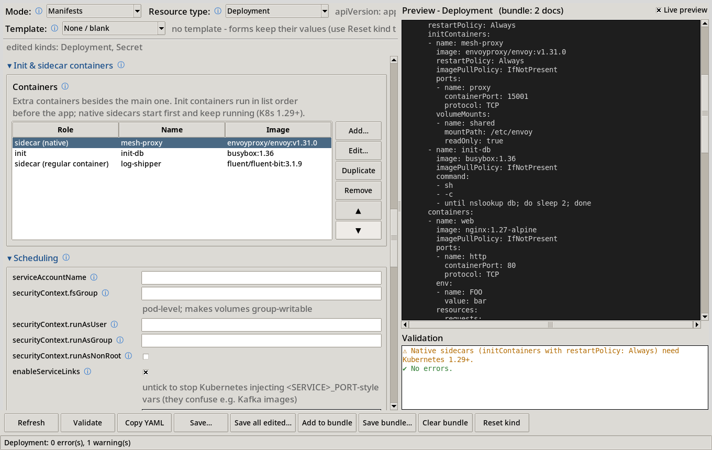

# Kubernetes Manifest Generator (desktop)

A desktop app (Python + Tkinter) that builds Kubernetes YAML, cluster configs and CNI/CSI add-on configs from forms.

[](https://github.com/johshea/k8s-manifest-desktop/actions/workflows/ci.yml)
[](https://www.python.org/downloads/)
[](LICENSE)



You fill in a form and get valid YAML, so you never hand-type indentation. Every field has an ⓘ tooltip
that says what it does, the format it takes and the YAML key it sets. The generator core has no GUI
dependency, so you can also use it from scripts and CI.

## Features

- **Three modes**, switched with the **Mode** selector:
  - **Manifests**: 14 kinds (Deployment, StatefulSet, DaemonSet, Job, CronJob, Service, Ingress,
    ConfigMap, Secret, PersistentVolumeClaim, Namespace, NetworkPolicy, StorageClass,
    VolumeSnapshotClass). Includes multi-container pods (init, sidecar and native sidecar),
    tolerations, affinity, topology spread and probes.
  - **Cluster config**: kubeadm, kind, kubeconfig, k3s / RKE2, minikube, k0s, MicroK8s, Talos,
    Kubespray, Cluster API, OpenShift, EKS, GKE and AKS.
  - **Networking & Storage**: CNI add-ons (Calico, Cilium, Flannel, Canal, Antrea, Multus) and CSI
    StorageClasses for 15 drivers (AWS EBS / EFS, GCE PD, Azure Disk / File, vSphere, Nutanix,
    NFS, SMB, Longhorn, Rook-Ceph RBD / CephFS, OpenEBS, TopoLVM, local-path). Each comes with an
    `install.sh` that pins verified versions.
- **25 application templates** (PostgreSQL, MySQL, Redis, Kafka, nginx, WordPress, ...). Each one
  fills several related kinds at once.
- **Live YAML preview** and **validation**: DNS names, label syntax, quantities, cron, ports and
  request ≤ limit. Optional cross-checks warn when a CNI's pod CIDR doesn't match the cluster's.
- **Save, Save all edited, bundles**: Secrets and kubeconfigs are written with mode 0600 and
  scripts with 0755.
- **Values are kept per kind** while the app is open. Switch kinds freely and come back to what you typed.

## Quick start

Python **3.10+** with Tk 8.6 is required.

### macOS

```bash
brew install python python-tk              # or use the python.org installer (Tk bundled)
git clone https://github.com/johshea/k8s-manifest-desktop.git && cd k8s-manifest-desktop
python3 -m venv .venv && source .venv/bin/activate
pip install -r requirements.txt
python k8s_manifest_gui.py
```

### Ubuntu / Debian

```bash
sudo apt install -y python3 python3-tk python3-venv
git clone https://github.com/johshea/k8s-manifest-desktop.git && cd k8s-manifest-desktop
python3 -m venv .venv && source .venv/bin/activate
pip install -r requirements.txt
python k8s_manifest_gui.py
```

Without a venv, `python3 k8s_manifest_gui.py` installs PyYAML on first run (`--user`). Use `--check`
to only verify dependencies, or `--no-install` to never install anything. See
[docs/installation.md](docs/installation.md) for the details.

## Usage overview

1. Pick a **Mode**, then a **Resource type**, a cluster **Config type** or an **Add-on type**. In
   Manifests mode you can also start from a **Template**.
2. Fill in the form. Hover over any ⓘ for help. Sections collapse, and tables (containers,
   tolerations, IP pools, ...) have Add / Edit / Duplicate / Remove buttons.
3. Watch the **YAML preview** and the **Validation** pane. Then **Copy**, **Save…**,
   **Save all edited…**, or add the result to a multi-document **bundle**.

From code:

```python
import manifest_gen as gen
res = gen.generate("Deployment", {"name": "web", "image": "nginx:1.27", "replicas": "3"})
print(gen.to_yaml(res.manifest) if res.ok else res.errors)
```

## Documentation

| Topic | Document |
|---|---|
| Installation, prerequisites, PyYAML auto-install | [docs/installation.md](docs/installation.md) |
| Manifests mode: features and field formats | [docs/manifests.md](docs/manifests.md) |
| Application templates and how to add one | [docs/templates.md](docs/templates.md) |
| Cluster config mode and how each platform was validated | [docs/cluster-config.md](docs/cluster-config.md) |
| Networking & Storage (CNI / CSI) mode | [docs/networking-storage.md](docs/networking-storage.md) |
| Hover help / field reference (`field_docs.py`) | [docs/tooltips.md](docs/tooltips.md) |
| Architecture, file layout, using the generator from code | [docs/architecture.md](docs/architecture.md) |
| Testing (offline suites, real-tool checks, kind clusters) | [docs/testing.md](docs/testing.md) |
| Troubleshooting | [docs/troubleshooting.md](docs/troubleshooting.md) |

There is also a [documentation index](docs/README.md).

## Project layout

```text
.
├── k8s_manifest_gui.py      # entry point (dependency check, launches the GUI)
├── gui_app.py               # Tkinter / ttk front-end
├── bootstrap.py             # dependency checks, PyYAML installer
├── manifest_gen.py          # ┐
├── cluster_config_gen.py    # │ GUI-free generator core
├── clusterplatforms/        # │
├── addons_gen.py, addons/   # │
├── app_templates.py         # │
├── field_docs.py            # │
├── providers.py             # ┘
├── tests/                   # test suites
├── docs/                    # documentation + docs/images
├── run_tests.sh             # runs every suite
└── .github/                 # CI, issue / PR templates, Dependabot
```

[docs/architecture.md](docs/architecture.md) explains what every file does.

## Testing

```bash
./run_tests.sh                     # all offline suites + GUI smoke test (xvfb-run on headless Linux)
python3 tests/test_generator.py    # one suite, headless
KIND_SUDO=1 ./run_tests.sh --kind --templates-kind   # optional real-cluster checks
```

The suites cover:

- manifest generation: 225 checks
- cluster configs: 222
- platforms: ~490
- application templates: ~2,300
- CNI / CSI add-ons: 289
- tooltip coverage for every field
- a GUI smoke test that drives every mode and dialog


## Contributing

Contributions are welcome. Please read [CONTRIBUTING.md](CONTRIBUTING.md) and the
[Code of Conduct](CODE_OF_CONDUCT.md). Report vulnerabilities as described in
[SECURITY.md](SECURITY.md). Changes are listed in [CHANGELOG.md](CHANGELOG.md).

## License

[MIT](LICENSE) © 2026 John Shea
